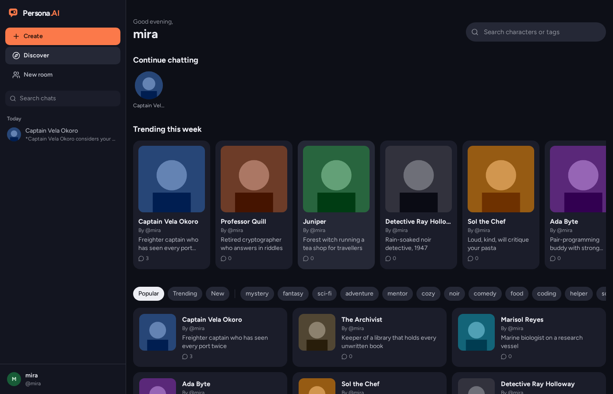
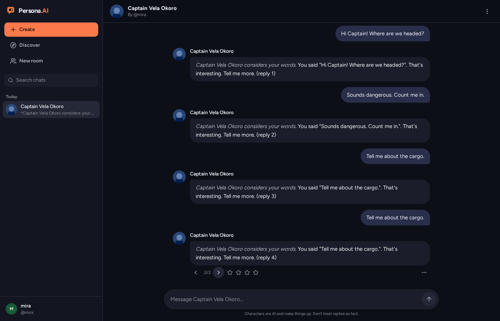
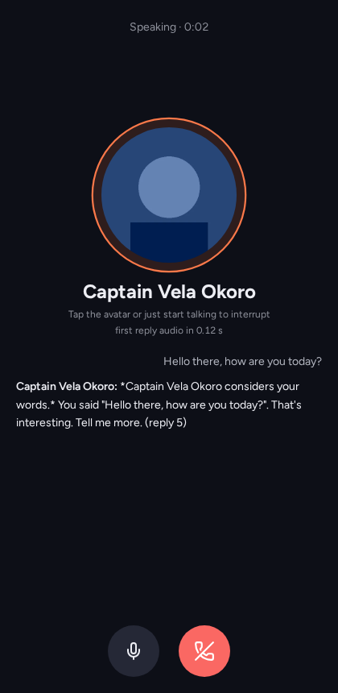

<p align="center">
  
</p>

<h1 align="center">Persona.AI</h1>

<p align="center">
  Self-hosted AI character chat. Discover and create characters, chat with streaming replies,
  swipe between answers, hear them speak, and call them, on hardware you control.
</p>

<p align="center">
  <a href="https://github.com/Cat-things/Persona.AI/actions/workflows/ci.yml"></a>
  <a href="LICENSE"></a>
</p>

> [!NOTE]
> Persona.AI is under active development. Expect breaking changes before 1.0.

<!-- Screenshots: replace these placeholders with real captures (docs/screenshots/*.png). -->
| Discover | Chat | Call |
|---|---|---|
|  |  |  |

## Features

- **Characters**: create and edit with name, tagline, description, greeting, example dialogs,
  avatar, voice, visibility (public / unlisted / private) and tags. Import and export
  SillyTavern Character Card V2 (JSON or PNG).
- **Discover**: featured, trending and new characters, search by name or tag.
- **Chat**: streaming replies, swipe between alternatives, regenerate, edit, delete, rewind,
  1 to 4 star ratings, multiple threads per character, chat history sidebar.
- **Memory**: pin messages or write memories that always stay in context, plus automatic rolling
  summaries for long chats, all fitted to each model's context size.
- **Personas and rooms**: choose who the character is talking to; group chats with several
  characters and turn-taking.
- **Voices**: play any reply aloud, auto-play, a browsable voice library, and voice cloning
  (only from audio you have the rights to).
- **Calls**: real-time voice calls with live transcript and barge-in (talk over the character
  to interrupt it).
- **Avatar generator**: four options from a prompt or the character description, style presets,
  circular crop.
- **Bring your own models**: any OpenAI-compatible LLM server (Ollama, KoboldCpp, LM Studio,
  llama.cpp, vLLM, OpenRouter, OpenAI) or Anthropic; ComfyUI, AUTOMATIC1111/Forge, OpenAI-compatible
  or fal.ai for images; Kokoro, Piper, XTTS-v2 or ElevenLabs for voices; faster-whisper or a
  Whisper API for speech recognition.
- **Train your own model**: users can opt in to share rated chats; export them (filtered and
  scrubbed), fine-tune an open model with LoRA, and load it into Ollama.
- **Admin panel**: users, characters, reports, invites, provider settings and health checks.
  API keys stay on the server.
- **Apps**: installable web app (PWA) and an Expo mobile app for Android and iOS.

## Quick start

On a Linux server or a Mac:

```bash
curl -fsSL https://raw.githubusercontent.com/Cat-things/Persona.AI/main/install.sh | bash
```

Piping a script into your shell runs it with your permissions.
[Read install.sh first](install.sh); it is plain Bash with comments.

The installer asks a few questions (Docker or native, domain, which AI backends) and then:

1. installs Docker (or the native dependencies), and optionally Ollama with a model sized to your
   hardware, ComfyUI, local voices and speech recognition;
2. writes a private `.env` with random secrets (never printed);
3. starts everything, with automatic HTTPS through Caddy if you gave it a domain;
4. prints the URL. **The first account you register becomes the admin.**

Scripted installs:

```bash
./install.sh --docker --yes --domain chat.example.com --email you@example.com
./install.sh --native --yes --llm external --llm-url https://openrouter.ai/api/v1   # key via PERSONA_LLM_API_KEY
```

Day-to-day management:

```bash
./install.sh update      # pull the latest version and restart
./install.sh backup      # database, media and config in one archive
./install.sh restore persona-20260101-120000.tar.gz
./install.sh doctor      # health check
./install.sh uninstall   # keeps your data unless you add --purge
```

Windows: run `install.ps1` from PowerShell. See [docs/install.md](docs/install.md) for every option.

## Hardware

| Setup | What runs well | Notes |
|---|---|---|
| **CPU only** (4+ cores, 8 GB RAM) | 3B to 8B models at a few words per second, Piper or Kokoro voices, Whisper `base`/`small` | Fine for one or two people. Use a cloud LLM (OpenRouter etc.) for faster replies. Image generation is very slow. |
| **8 GB VRAM** (RTX 3060/4060, M1/M2 16 GB) | 8B models (Llama 3.1 8B), Kokoro, Whisper `small`, SD 1.5 avatars | Calls typically reach first audio in about 1 to 1.5 s. |
| **16 GB+ VRAM** (RTX 4080/4090, M-series 32 GB+) | 12B to 24B models, SDXL/Flux avatars, XTTS-v2 cloning alongside the LLM | Room for several users at once. |

A Raspberry Pi 5 (arm64) runs the app itself fine; point it at an LLM elsewhere.

## Documentation

- [Installation and options](docs/install.md)
- [Configuration reference](docs/configuration.md)
- [AI providers](docs/providers.md)
- [Choosing models](docs/models.md) and [training your own](training/README.md)
- [Architecture](docs/architecture.md)
- [Development](docs/development.md)
- [Mobile app](docs/mobile.md)
- [Troubleshooting](docs/troubleshooting.md)
- [Roadmap and progress](PLAN.md)

## Troubleshooting

The short version (more in [docs/troubleshooting.md](docs/troubleshooting.md)):

- **Run the doctor first:** `./install.sh doctor` checks the database, disk, and each AI provider.
- **"Could not reach LLM"**: is Ollama running (`ollama list`)? In Docker mode the URL is
  `http://ollama:11434/v1`; for an LLM on the host use `http://host.docker.internal:11434/v1`.
- **Can't open the site from another computer**: without a domain, Persona.AI only listens on
  127.0.0.1. Use an SSH tunnel, re-run with `--domain`, or (on a trusted LAN) `--lan`.
- **HTTPS certificate not issued**: the domain's DNS must point at this server and ports 80 and 443
  must be reachable.
- **Microphone doesn't work in calls**: browsers only allow the mic on HTTPS or `localhost`.
- **GPU not used in Docker**: install the NVIDIA Container Toolkit (the installer offers to) and
  check `docker run --rm --gpus all nvidia/cuda:12.4.0-base-ubuntu22.04 nvidia-smi`.

## Contributing

Contributions are welcome. Please read [CONTRIBUTING.md](CONTRIBUTING.md) and the
[Code of Conduct](CODE_OF_CONDUCT.md). To report a vulnerability, see [SECURITY.md](SECURITY.md);
please don't open a public issue for it.

## License

[AGPL-3.0](LICENSE). If you run a modified version as a network service, you must offer its
source to its users. Persona.AI is an independent project and is not affiliated with Character.AI.
